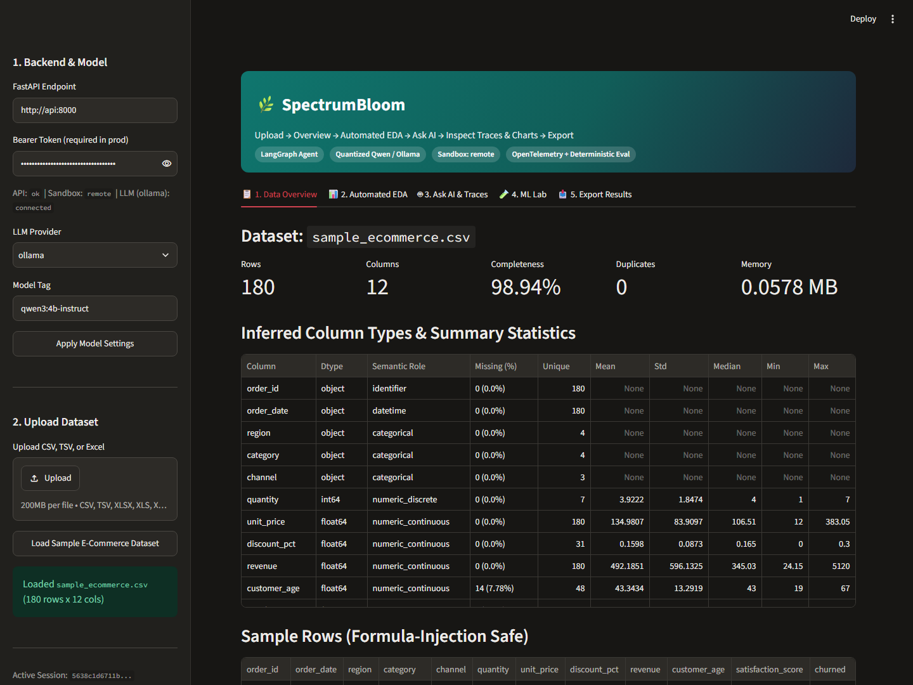
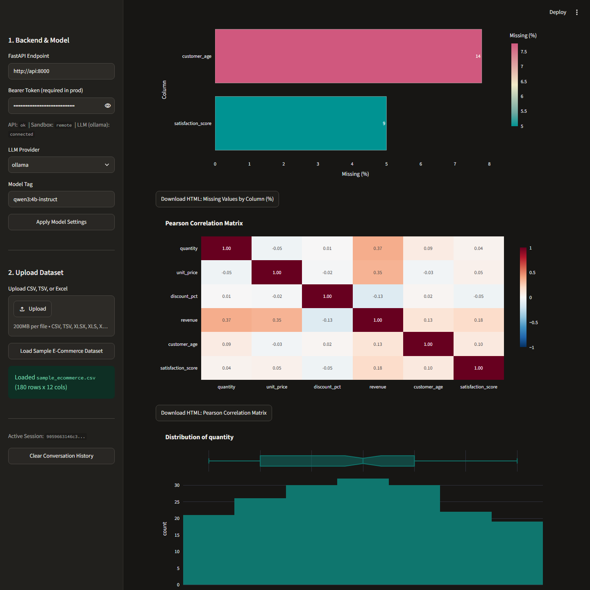
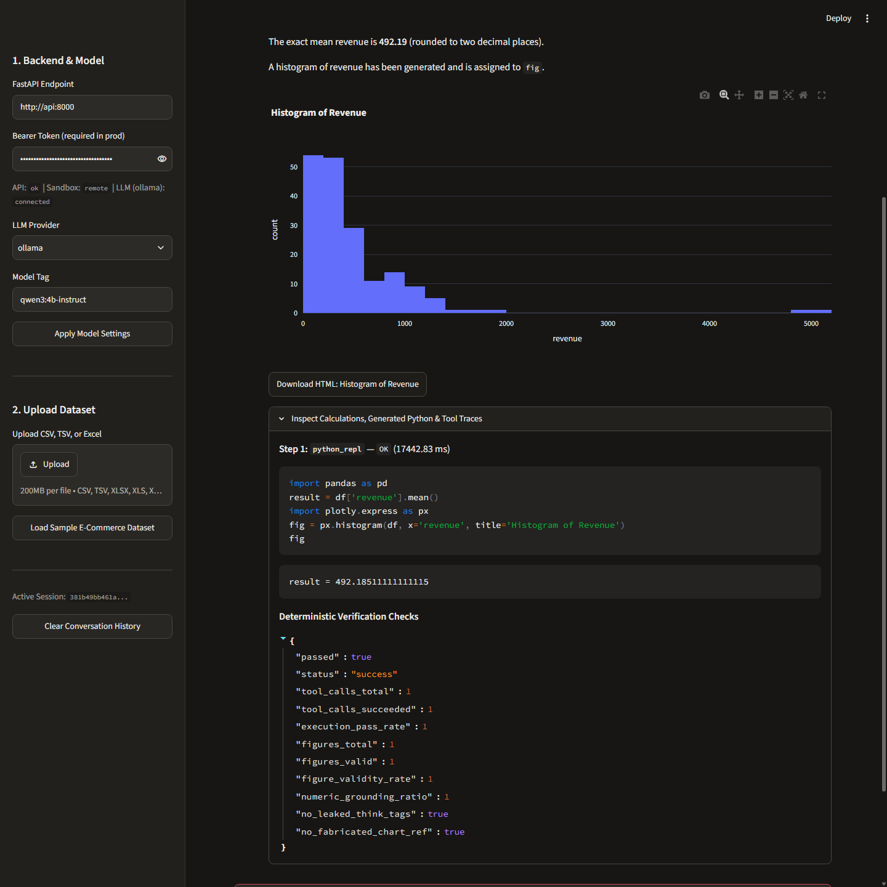
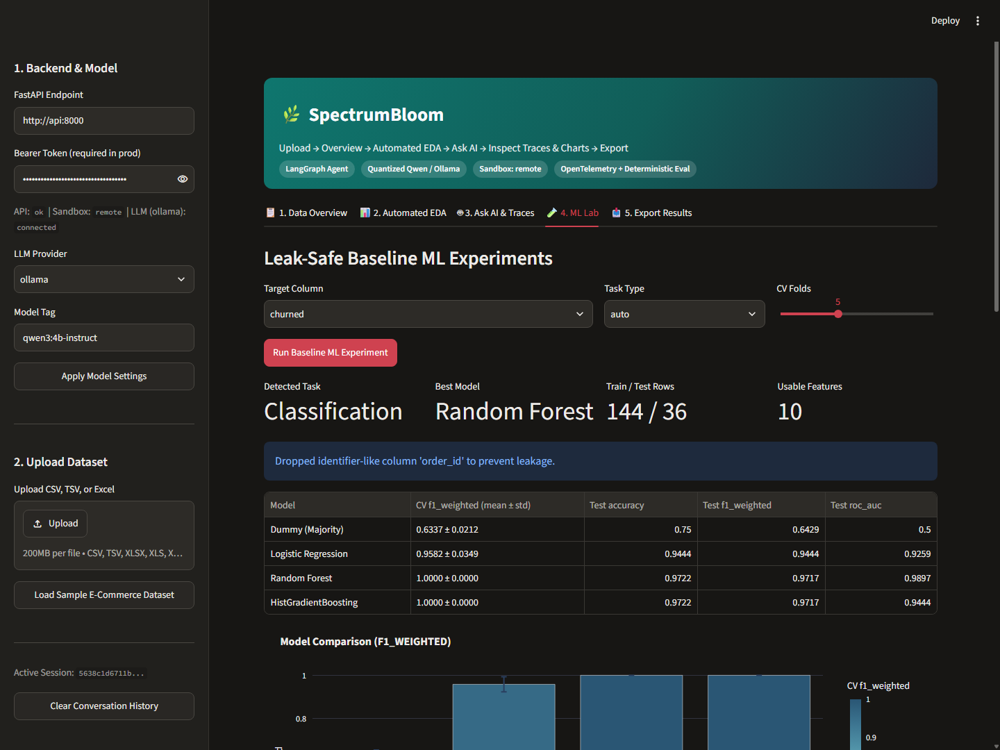
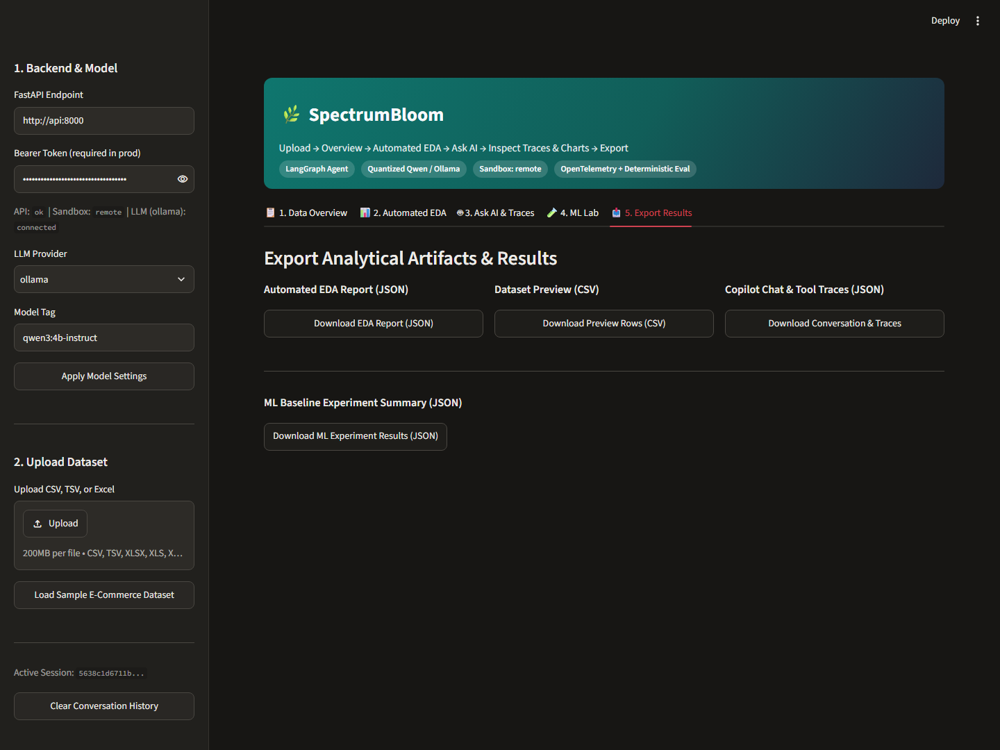

# SpectrumBloom

**Local-first, fail-closed, production-oriented Agentic Exploratory Data Analysis (EDA) platform.**

SpectrumBloom is an independently engineered modular monolith built with **FastAPI**, **Pydantic v2**, **LangGraph**, deterministic statistical & Plotly EDA engines, a **fail-closed sandboxed Python runtime**, **OpenTelemetry + Langfuse + DeepEval** evaluation/observability, and **local quantized Qwen inference** tuned for **4 GB VRAM consumer GPUs** (e.g., NVIDIA RTX 3050 4 GB via **Ollama** or **llama.cpp**), with external cloud LLMs strictly optional.

---

## Architecture Overview

```text
Streamlit UI (src/spectrumbloom/ui/app.py) — 5-tab interactive studio
   │ HTTP REST (httpx + Bearer Token)
   ▼
FastAPI Gateway (src/spectrumbloom/api/routes.py)  ── Bearer Auth + CORS + Prod/Host Guards + OTel
   │
   ▼
SpectrumBloomService (src/spectrumbloom/services/session_service.py)
   ├── Repositories (repositories/)       : Thread-safe Memory / Redis sessions + Local / S3 datasets
   ├── Deterministic EDA (eda/)           : Zip-bomb guarded loader, profiler, stats engine, Plotly builder
   ├── Leak-Safe ML Lab (ml/)             : Pipeline + ColumnTransformer CV baseline benchmark + permutation imp
   ├── LangGraph Agent (agent/, llm/)     : Deterministic-first tools + conditional python_repl + timeout/retry bounds
   ├── Isolated Sandbox Boundary (sandbox/):
   │      ├── Compose: RemoteDockerSandbox ─(internal HTTP + token)─▶ sandbox-executor ─▶ DockerSandbox (no sock on API!)
   │      ├── Host:    DockerSandbox (--network=none --read-only --cap-drop=ALL --pids-limit=64 --cpus=1 --memory)
   │      ├── Public:  DisabledSandbox (HF Spaces / Cloud Run — deterministic EDA + ML only, zero arbitrary Python)
   │      └── Dev:     SubprocessSandbox (strict_subprocess restricted to APP_ENV=development; JobObj/POSIX rlimits)
   └── Eval & Telemetry (services/, core/): Deterministic turn verifier, DeepEval Ollama judge, OTel + Langfuse
```

See full architectural details in [docs/architecture.md](docs/architecture.md), security & clean-room audit findings in [docs/reference-audit.md](docs/reference-audit.md), and local 4 GB VRAM benchmarks in [docs/optimization-report.md](docs/optimization-report.md).

---

## Interactive UI Workspace

**Upload dataset → Data Overview → Automated EDA → Ask AI & Traces → ML Lab → Export Results**

Captured live from the containerized Streamlit UI connected to FastAPI, isolated `sandbox-executor`, and Ollama (`qwen3:4b-instruct`):

| Data Overview & Inferred Types | Automated EDA & Interactive Plotly Charts |
| :---: | :---: |
|  |  |

| Ask AI, Python Traces & Verification Checks | Leak-Safe Baseline ML Lab & Exports |
| :---: | :---: |
|  |  |

> Full Artifact Export Panel: 

---

## Core Capabilities

1. **Deterministic & Visual EDA (`eda/`)**
   - Hardened tabular ingestion (`csv`, `tsv`, `txt`, `xlsx`, `xlsm`, `xls`, `ods`) with byte-size limit, encoding fallback, CSV delimiter sniffing, Excel formula-injection neutralization, and XML zip-bomb bounds (`loader.py`).
   - Semantic column typing (`numeric_continuous`, `numeric_discrete`, `categorical`, `boolean`, `datetime`, `identifier`, `text`, `empty`), skewness/kurtosis, and data quality alerts (`profiler.py`).
   - Deep statistical diagnostics (`statistics.py`): missingness co-occurrence pairs, Pearson & Spearman correlations, Cramér's V categorical associations, Shapiro-Wilk / D'Agostino normality tests, IQR / Z-score / robust MAD outliers, `IsolationForest` multivariate anomalies, and Kruskal-Wallis group tests.
   - Interactive Plotly visualizations (`charts.py`): missingness heatmap, numeric distributions, correlation matrix, box/outlier diagnostics, top categorical breakdowns, and standalone HTML chart exports.

2. **Deterministic-First Agentic EDA (`agent/`, `llm/`)**
   - Local-first inference via `UnifiedLLMProvider` supporting **Ollama** (`qwen3:4b-instruct` default, `num_ctx=4096`), **llama.cpp** OpenAI-compatible server, and optional external **OpenAI-compatible** or **Gemini** endpoints, guarded by configurable `LLM_TIMEOUT_SECONDS` (`LLMTimeoutError`).
   - Stateful LangGraph orchestration (`EDAAgentGraph`) preferring deterministic tools (`get_statistical_summary`, `aggregate_data`, `compute_statistical_test`, `create_standard_chart`, `run_ml_baseline`) and invoking sandboxed `python_repl` only for custom calculations/plots.
   - Supports native tool-calling plus `<tool_call>` XML, bare JSON, ````json`, and ````python` fallback parsing, context-window compaction (`num_ctx=4096`), bounded self-repair retries (`MAX_REPAIR_RETRIES = 2`), explicit `FIGURES_GENERATED` accounting, and fail-closed error states.

3. **Fail-Closed Python Execution Sandbox (`sandbox/`)**
   - **Never** falls back or downgrades to unrestricted execution when a configured isolation backend is unavailable (`SandboxUnavailableError`).
   - Static AST gate rejects disallowed imports, dunder traversal, `eval`/`exec`/`getattr`/`open`, and pandas `df.eval()` / `df.query()`, transferring DataFrames strictly via PyArrow Parquet / typed JSON (never `pickle`).
   - **Isolation Boundaries:**
     - `remote` (`RemoteDockerSandbox` → `sandbox/executor_app.py`, Compose default): isolates the Docker daemon behind an internal authenticated service so `spectrumbloom-api` never mounts `/var/run/docker.sock`.
     - `docker` (`DockerSandbox` + `Dockerfile.sandbox`): non-privileged per-run Linux container (`--network=none --read-only --cap-drop=ALL --security-opt=no-new-privileges:true --user=10001:10001 --pids-limit=64 --cpus=1 --memory=... --tmpfs=/tmp:rw,noexec,nosuid,size=16m`), bytecode-compiled wheels + lazy imports for fast cold startup.
     - `disabled` (`DisabledSandbox`): disables dynamic `python_repl` in multi-tenant/serverless public deployments (HF Spaces / Cloud Run) while keeping all deterministic EDA, ML Lab, and deterministic copilot tools working.
     - `strict_subprocess` (local `APP_ENV=development` only — rejected everywhere else): **process-level defense-in-depth**, *not* OS container isolation (`python -I`, stripped env, socket/DNS kill-switch, prefix-locked `open()`, Windows Kernel Job Objects or POSIX `rlimit` + RSS watchdog).
     - `nsjail` (`sandbox/nsjail.cfg`): optional Linux namespace adapter (implemented fail-closed; not E2E tested without a native `nsjail` binary).

4. **Separate Baseline ML Lab (`ml/experiments.py`)**
   - Leak-safe `ColumnTransformer` + `Pipeline` with cross-validation (`Dummy`, `LogisticRegression`/`Ridge`, `RandomForest`, `HistGradientBoosting`), identifier-column leakage dropping, held-out test metrics, permutation feature importance, and interactive Plotly diagnostics.

5. **Evaluation, Observability & Optimization (`services/eval_service.py`, `optimization/`)**
   - Automated per-turn verification (tool execution success, Plotly JSON validity, tolerance-aware numeric grounding, `<think>` leakage & ungrounded chart-reference guards) + optional `DeepEval` `GEval` groundedness scoring backed by a local Ollama judge (`OllamaDeepEvalJudge`).
   - OpenTelemetry trace/metric instrumentation (`core/telemetry.py`, compatible with Jaeger / OTLP) and optional Langfuse callbacks.

---

## Empirical End-to-End Agent Benchmark (67 Tasks × 6 Datasets, RTX 3050 4 GB)

Evaluated across **67 analytical tasks spanning 6 diverse datasets** (`sample_ecommerce.csv`, `palmer_penguins.csv`, `breast_cancer_uci.csv`, `wine_cultivars_uci.csv`, `us_macro_fred.csv`, `mauna_loa_co2.csv`; provenance & SHA-256 checksums in [`benchmarks/datasets/PROVENANCE.md`](benchmarks/datasets/PROVENANCE.md)) over **2 back-to-back repeats** inside `DockerSandbox` (`Ollama`, `num_ctx=4096`):

| Model | Run | Correctness | Tool Exec (Std / All) | Retry Rate | Timeouts | P50 (s) | P95 (s) | GPU Offload | Peak VRAM (MB) |
| --- | ---: | ---: | ---: | ---: | ---: | ---: | ---: | ---: | ---: |
| `qwen2.5-coder:1.5b-instruct-q4_K_M` | 1 | 48/67 (71.6%) | 51.7% / 51.9% | 47.8% | 0 | 4.76 | 22.66 | 100.0% | 1390.0 |
| `qwen2.5-coder:1.5b-instruct-q4_K_M` | 2 | 47/67 (70.1%) | 51.4% / 51.6% | 47.8% | 0 | 4.96 | 14.28 | 100.0% | 1489.0 |
| `qwen2.5-coder:3b-instruct-q4_K_M` | 1 | 47/67 (70.1%) | 77.1% / 71.0% | 20.9% | 0 | 4.59 | 14.43 | 100.0% | 2407.0 |
| `qwen2.5-coder:3b-instruct-q4_K_M` | 2 | 47/67 (70.1%) | 78.3% / 72.0% | 19.4% | 0 | 4.40 | 12.18 | 100.0% | 2407.0 |
| **`qwen3:4b-instruct` (Default)** | **1** | **61/67 (91.0%)** | **90.8% / 90.8%** | **9.0%** | **0** | **11.72** | **33.91** | 66.3% | 2623.0 |
| **`qwen3:4b-instruct` (Default)** | **2** | **61/67 (91.0%)** | **90.6% / 90.6%** | **9.0%** | **0** | **17.49** | **40.75** | 66.3% | 2617.0 |

- **`qwen3:4b-instruct` selected as empirical default:** Exceeds the **≥90% correctness target (91.0%, 100% repeat agreement)** and **≤45 s P50 / ≤120 s P95** latency targets despite partial host RAM offloading (`66.3%` GPU, `2236 / 3371 MB`), outperforming 1.5B (`70.1–71.6%`) and 3B (`70.1%`, `0/3` multi-step) across complex schemas, invalid-column handling (`100%`), and statistical tests (`100%`).
- **Transparent target gap:** Tool execution on `qwen3:4b-instruct` measured **90.6–90.8%** vs the 95% stretch target due to ~6 recoverable first-attempt Pydantic schema retries (`9.0%` retry rate). See [docs/optimization-report.md](docs/optimization-report.md) for per-category tables, the 6 recurring failure cases, the earlier 8-task quantization sweep (`Q2_K`/`Q4_K_M`/`Q8_0`), analytical 4 GB VRAM/QLoRA budgets, and execution-verified SFT trajectories ([`benchmarks/distilled_eda_sft.jsonl`](benchmarks/distilled_eda_sft.jsonl)).

---

## Verification, Estimates & Implementation Status

| Component | Status | Evidence / Scope |
| --- | --- | --- |
| FastAPI REST + Deterministic EDA + Leak-Safe ML + Auth Guards | Verified | Unit & integration tests (`tests/`), strict prod/non-loopback auth guards |
| Security Isolation Suite (FS, network, fork/spawn, OOM/CPU, missing backend, disabled mode) | Verified | `tests/unit/test_sandbox_security.py`, `tests/unit/test_security_config.py`, `tests/integration/test_docker_sandbox.py` |
| Isolated Docker Compose Stack (`api` → `sandbox-executor` → `spectrumbloom-sandbox` + `ui`) | Verified E2E | Live `docker compose up --build --wait`, `/api/v1/sessions/*/query` `python_repl` Plotly execution (`7.66 s`), zero `docker.sock` mount on `api`, live UI screenshots |
| 67-Task Multi-Dataset Agent Evaluation Suite | Measured | 3 models × 2 repeats inside `DockerSandbox` ([`latest_workflow_benchmark.json`](benchmarks/results/latest_workflow_benchmark.json)) |
| Historical 8-Task Quantization Sweep (`Q2_K` / `Q4_K_M` / `Q8_0` / `Qwen3-4B`) | Measured | Baseline microbenchmark in [`benchmarks/results/latest_benchmark.json`](benchmarks/results/latest_benchmark.json) & `latest_tool_benchmark.json` |
| Inference VRAM Budget & QLoRA Memory Table (`vram_budget.py`, `qlora.py`) | Analytical estimate | Formula-based VRAM bounds + `qlora.py --check-only`; CUDA weight updates **not run** |
| SFT Trajectory Distillation (`distillation.py`) | Executed (dataset only) | Generated `6/8` execution-verified JSONL examples; downstream PyTorch QLoRA fine-tuning **not run** |
| `NsjailSandbox`, `RedisSessionRepository`, `S3DatasetStore`, `llama.cpp`, External OpenAI/Gemini, Live OTLP/Langfuse/DeepEval, Cloud Run, HF Spaces | Implemented, not E2E tested live | Code/adapters/manifests implemented & tested offline or fail-closed (`SANDBOX_BACKEND=disabled` for public demos); live remote deployments not run |

---

## Quickstart (Local Setup)

### 1. Prerequisites
- Python **3.12** (supported: `>=3.11,<3.14`) and [`uv`](https://docs.astral.sh/uv/)
- **Docker** (required for default `SANDBOX_BACKEND=docker` and isolated Compose execution; local `APP_ENV=development` workstations without Docker can explicitly opt into `SANDBOX_BACKEND=strict_subprocess`)
- Local **Ollama** (`ollama pull qwen3:4b-instruct`) or **llama.cpp** OpenAI-compatible server

### 2. Install & Configure
```bash
uv venv --python 3.12 .venv
# Linux / macOS: source .venv/bin/activate
# Windows PowerShell: .\.venv\Scripts\Activate.ps1

uv pip install -e ".[eval,dev]"
cp .env.example .env
docker build -f Dockerfile.sandbox -t spectrumbloom-sandbox:latest .
```

### 3. Start Backend API & Streamlit UI
Terminal 1 — FastAPI backend:
```bash
uvicorn spectrumbloom.main:app --host 127.0.0.1 --port 8000
```
Terminal 2 — SpectrumBloom UI:
```bash
streamlit run src/spectrumbloom/ui/app.py --server.port 8501
```
Then open `http://localhost:8501` (API interactive docs at `http://127.0.0.1:8000/docs`), or run the standalone REST workflow script:
```bash
python examples/sample_api_workflow.py
```

---

## REST API Surface

| Method | Path | Purpose |
| --- | --- | --- |
| `GET` | `/health` | Readiness & dependency status (storage, sandbox, LLM, OTel/Langfuse) |
| `POST` | `/api/v1/sessions` | Create an isolated EDA session (provider/model config) |
| `GET` | `/api/v1/sessions` | List active sessions |
| `GET` | `/api/v1/sessions/{session_id}` | Session status & active dataset metadata |
| `PATCH` | `/api/v1/sessions/{session_id}/provider` | Switch LLM provider/model at runtime |
| `POST` | `/api/v1/sessions/{session_id}/clear` | Clear session conversation history |
| `DELETE` | `/api/v1/sessions/{session_id}` | Delete session and optionally clean stored dataset |
| `GET` | `/api/v1/sessions/{session_id}/history` | Retrieve chat history & last tool traces |
| `POST` | `/api/v1/sessions/{session_id}/upload` | Upload CSV/TSV/Excel/ODS dataset and run full deterministic EDA |
| `GET` | `/api/v1/sessions/{session_id}/data/preview` | Formula-safe paginated dataset preview |
| `GET` | `/api/v1/sessions/{session_id}/eda` | Retrieve cached dataset profile, stats & Plotly charts |
| `POST` | `/api/v1/sessions/{session_id}/ml/experiment` | Run leak-safe CV baseline ML comparison & permutation importance |
| `POST` | `/api/v1/sessions/{session_id}/query` | Execute a multi-step agentic EDA query with evaluation |

`API_HOST` defaults to `127.0.0.1` to prevent accidental unauthenticated network exposure. When `APP_ENV=production` or `staging`, startup requires a strong `API_AUTH_TOKEN` (`>= 16` chars, non-placeholder) and disallows wildcard CORS (`*`). In `development`, binding a non-loopback `API_HOST` without `API_AUTH_TOKEN` is rejected at startup. When configured, `/api/v1/*` routes enforce `Authorization: Bearer <token>`.

---

## Docker Compose & Optional Deployments

- **Non-privileged Docker Compose (`cap_drop: ALL`, `no-new-privileges: true`):**
  ```bash
  docker compose up --build
  ```
  Optional profiles add Redis persistence (`--profile persistence`), containerized Ollama (`--profile local-llm`), or Jaeger OpenTelemetry tracing (`--profile observability`).
- **Optional Hugging Face Spaces Demo:** See [`deploy/hf-spaces/README.md`](deploy/hf-spaces/README.md).
- **Optional Google Cloud Run:** See [`deploy/gcp/README.md`](deploy/gcp/README.md) (no mandatory paid services required for local use).

---

## Tests, Benchmarks & Quality Checks

```bash
ruff check src tests benchmarks/prepare_datasets.py
ruff format --check src tests benchmarks/prepare_datasets.py
pytest -v

# Re-prepare the 6 evaluation datasets and run the 67-task agent workflow benchmark
python benchmarks/prepare_datasets.py
python -m spectrumbloom.optimization.workflow_benchmark --sandbox-backend docker --num-ctx 4096 --repeats 2
python -m spectrumbloom.optimization.vram_budget
python -m spectrumbloom.optimization.qlora --check-only --model-id Qwen/Qwen3-4B
```

---

## Repository Layout

```text
SpectrumBloom/
├── .github/workflows/ci.yml        # Ruff + Pytest + Docker build CI (API, Sandbox, Executor)
├── benchmarks/                     # 67-task eval suite, 6-dataset provenance, benchmark JSON/MD results
├── deploy/
│   ├── gcp/                        # Optional Google Cloud Run manifest & guide (SANDBOX_BACKEND=disabled)
│   └── hf-spaces/                  # Optional single-container HF Spaces demo (SANDBOX_BACKEND=disabled)
├── docs/                           # Architecture, reference audit, optimization report & UI screenshots
├── examples/                       # Sample e-commerce CSV & REST client workflow script
├── src/spectrumbloom/
│   ├── agent/                      # LangGraph state machine, deterministic/sandbox tools & repair loop
│   ├── api/                        # FastAPI routers & dependency injection
│   ├── core/                       # Settings, security utilities, OTel + Langfuse setup
│   ├── domain/                     # Pydantic contracts, interfaces & typed exceptions
│   ├── eda/                        # Loader, profiler, statistics engine & Plotly charts
│   ├── llm/                        # Ollama, llama.cpp & optional provider factory + prompts
│   ├── ml/                         # Separate leak-safe ML baseline pipeline & permutation imp
│   ├── optimization/               # VRAM estimator, workflow/quant benchmarkers, distillation & QLoRA guard
│   ├── repositories/               # Memory/Redis session stores & Local/S3 dataset stores
│   ├── sandbox/                    # AST gate, isolated runner, Docker/Remote executor service, JobObj/rlimits
│   ├── services/                   # SessionService & deterministic + DeepEval evaluators
│   └── ui/                         # 5-tab Streamlit REST UI workspace
├── tests/                          # Security, sandbox, EDA, ML, API workflow & Docker isolation tests
├── Dockerfile                      # Non-root API/UI runtime image
├── Dockerfile.executor             # Isolated internal Docker executor service image
├── Dockerfile.sandbox              # Air-gapped non-root sandbox image (--compile-bytecode)
├── docker-compose.yml              # Multi-network Compose stack (api -> sandbox-executor -> sandbox)
├── LICENSE                         # MIT License
└── pyproject.toml                  # Hatchling build & optional extras (eval, redis, s3, optimization)
```

---

## License

Released under the [MIT License](LICENSE). Clean-room implementation inspired conceptually by [Anas-Abd-ElAziz/Data-science-agent](https://github.com/Anas-Abd-ElAziz/Data-science-agent) with independent architecture, local-first LLM optimization, fail-closed security isolation, and comprehensive testing.
